<p align="center">
  
</p>

<h1 align="center">¡Hola! Soy Alfred</h1>

<p align="center">
  <strong>Tu asistente docente inteligente, privado y local.</strong><br />
  Estoy aquí para ayudarte a organizar tus clases, acompañar a tu alumnado y preparar cada día con más calma.
</p>

Alfred es una plataforma local-first de asistencia docente. Combina Next.js, memoria estructurada en
SQLite y siete agentes coordinados. Las cuentas locales distinguen a quienes acceden y reservan las
operaciones administrativas al rol `admin`; el espacio docente sigue siendo compartido entre las
cuentas y no implementa aislamiento de datos por usuario. ChatGPT es el único proveedor de razonamiento
generativo; las reglas locales se limitan a validación, cálculos deterministas y controles de seguridad.

## Estado

La base funcional está implementada: múltiples conversaciones independientes con
historial y contexto propio, Alfred disponible como asistente flotante consciente de la pantalla,
confirmaciones idempotentes, gestión de clases y altas masivas de alumnos, observaciones editables y confirmadas,
recuperación de memoria, tutorías asistidas opcionalmente por ChatGPT, acuerdos, solver determinista de
asientos y plano 5×5 editable. La primera fase del Planificador Docente añade horarios recurrentes,
asignaturas, unidades, contenidos, sesiones idempotentes, creación de horarios completos por lenguaje
natural y un organizador semanal editable. **Mis asignaturas** separa cada combinación de asignatura y
grupo e incorpora una ficha académica por alumno con calificaciones ponderadas, progreso, participación,
tareas, notas y apoyos. **Mi tutoría** es un espacio independiente para el grupo tutor, el seguimiento
general, las reuniones familiares y sus acuerdos. Ese espacio incluye además comentarios recibidos del
profesorado: Alfred conserva el texto original, propone una versión editable para comunicar a la familia
y, tras confirmación docente, la guarda en la próxima tutoría. El panel
de Administración muestra los siete agentes, su estado, capacidades, actividad y estadísticas;
permite controlarlos, revisar sus intercambios A2A 1.0 y consultar metadatos de trazas. Los cuerpos de
petición y respuesta no se presentan en Administración; las trazas históricas se devuelven redactadas.
También permite explorar
SQLite, borrar registros o áreas con confirmación reforzada y exportar conjuntos seleccionados a CSV o a
un libro Excel con varias hojas. Las tarjetas de agentes generativos muestran consumo total y medio, junto
con una comparación visual. El menú lateral puede colapsarse y conserva la preferencia local. El
recorrido crítico está automatizado con Playwright. Alfred expone además un adaptador A2A 1.0 para
descubrimiento e interoperabilidad, sin convertir los agentes internos en microservicios. En producción
requiere sesión `admin` y se alcanza detrás de Tailscale.

## Vista previa

| Inicio | Alfred contextual |
|---|---|
| 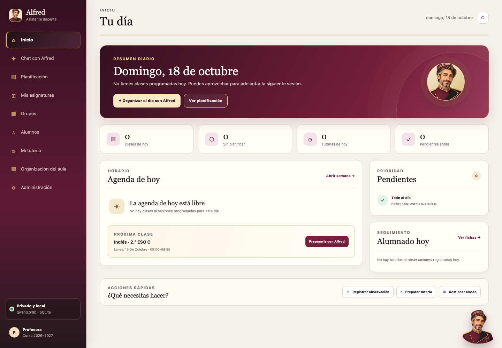 | 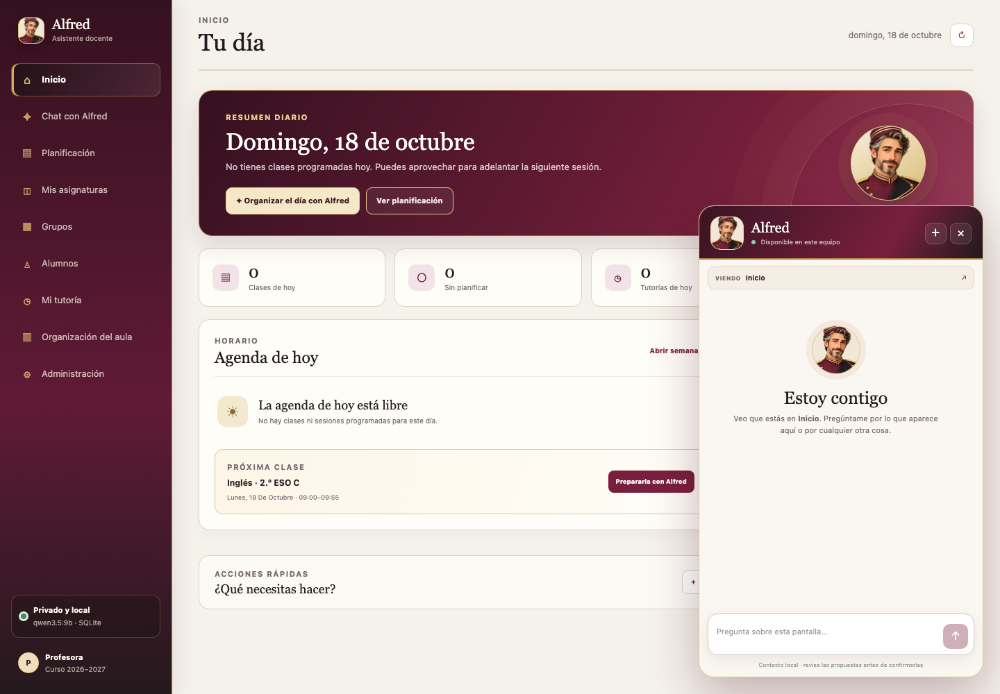 |

| Chat | Planificación |
|---|---|
| 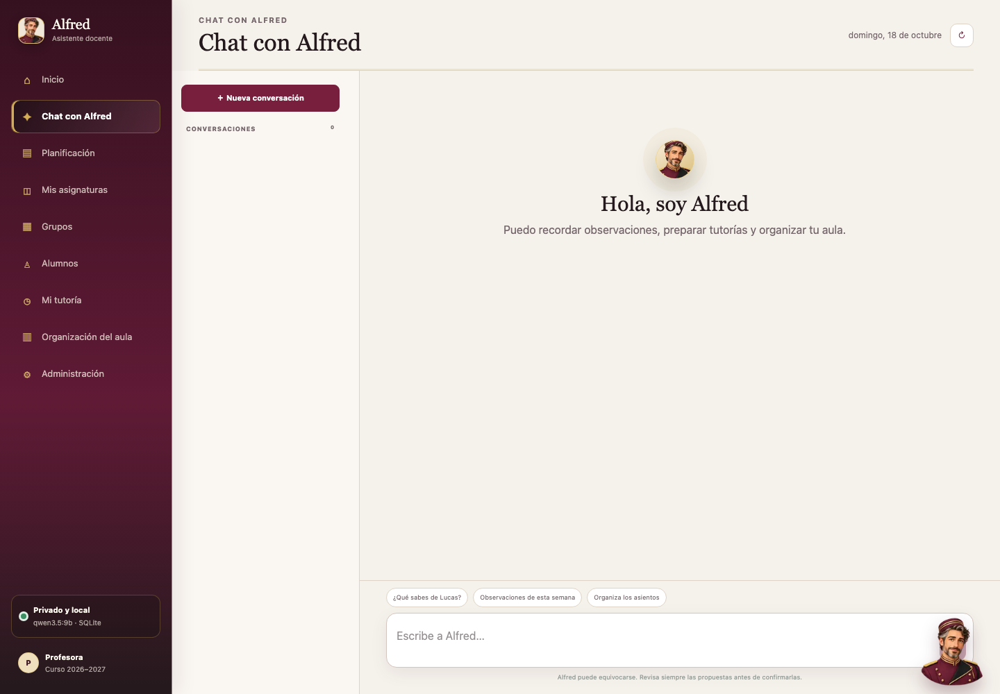 | 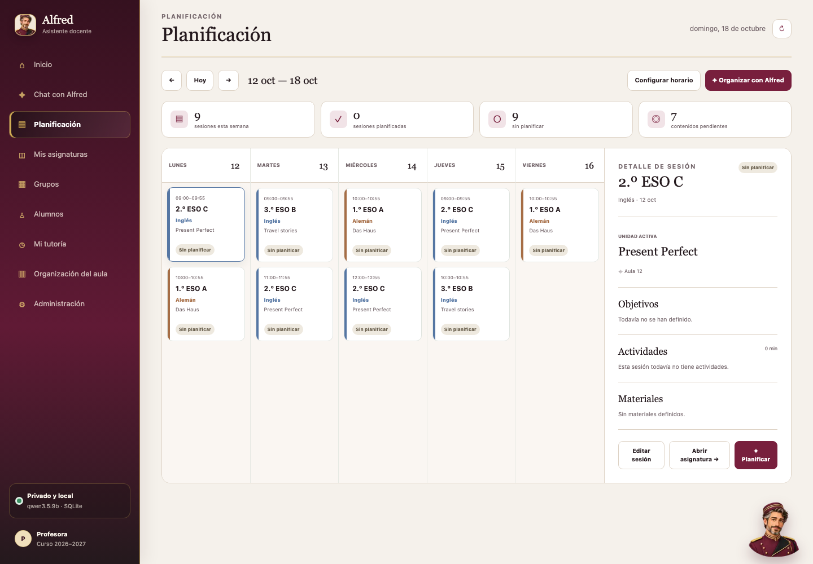 |

| Asignatura | Grupo |
|---|---|
| 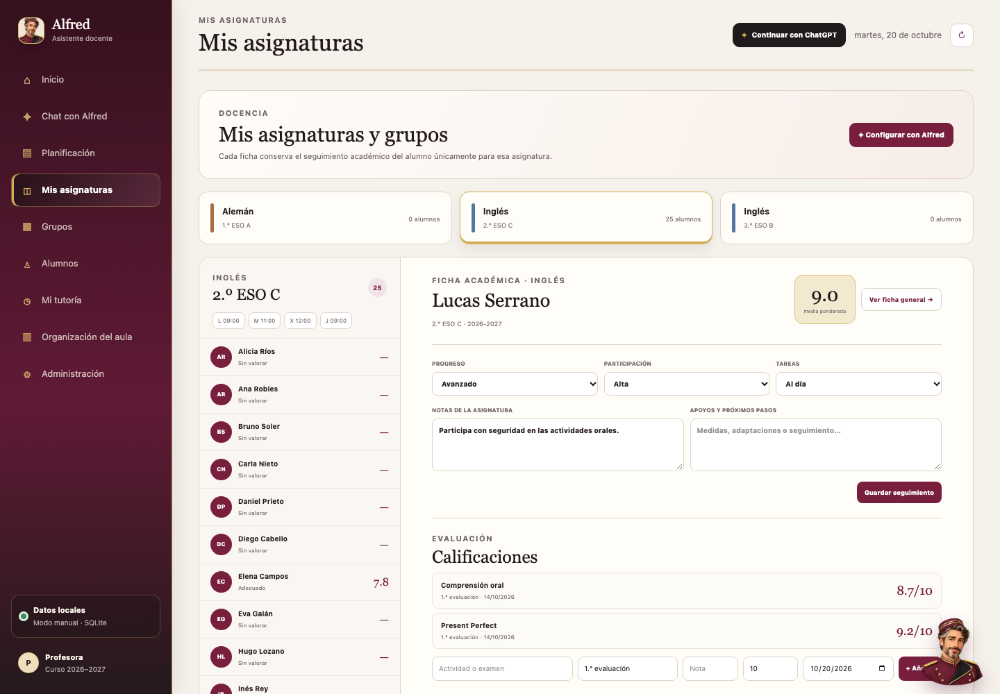 | 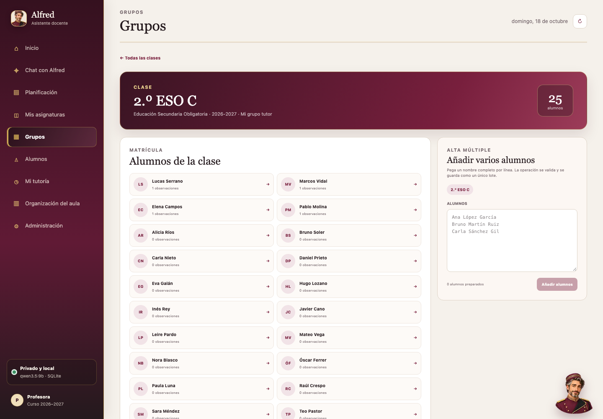 |

| Alumno | Tutoría |
|---|---|
| 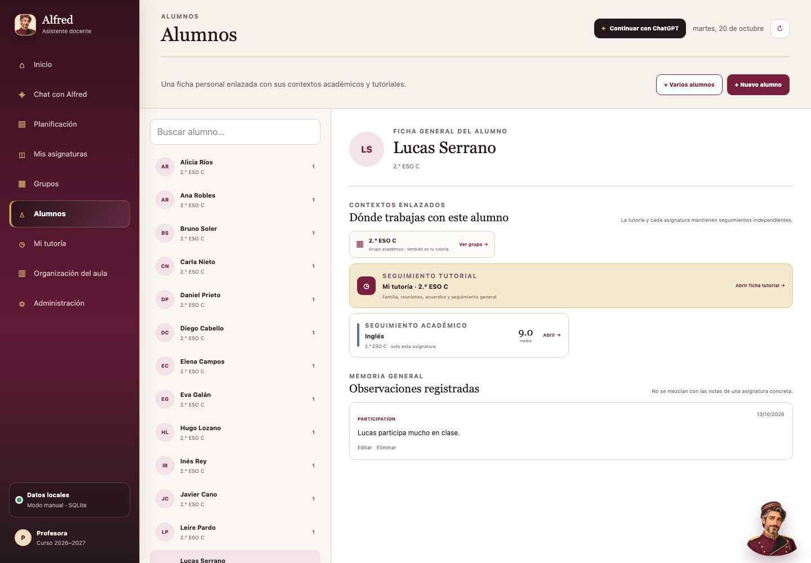 | 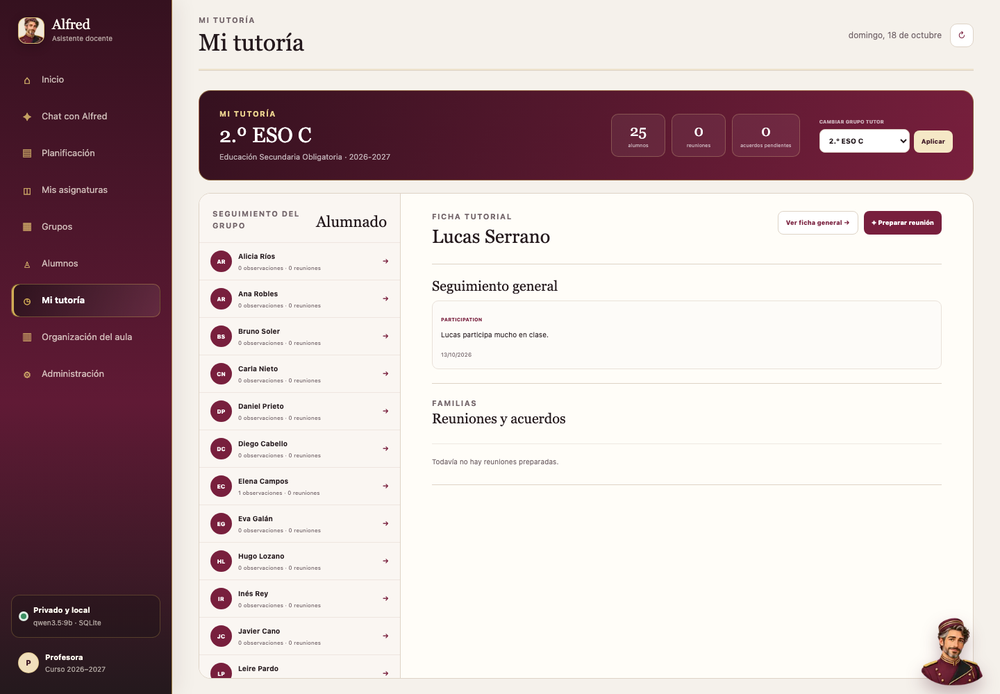 |

| Organización del aula | Agentes |
|---|---|
| 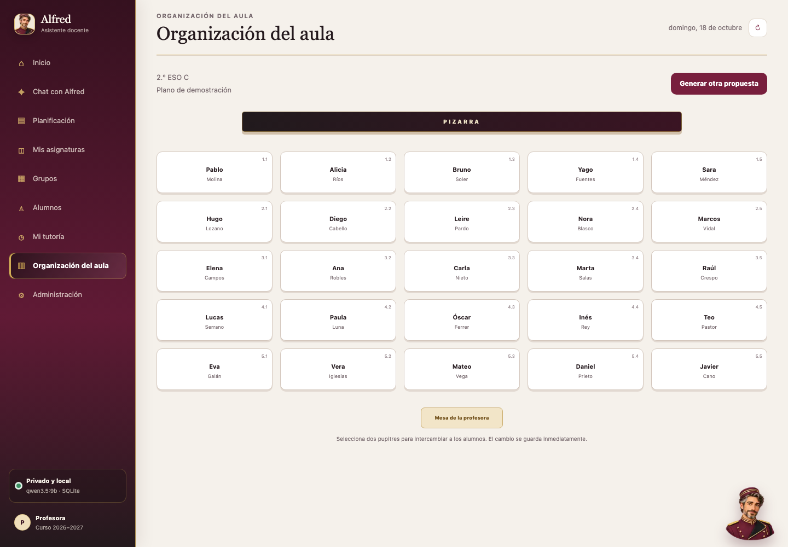 | 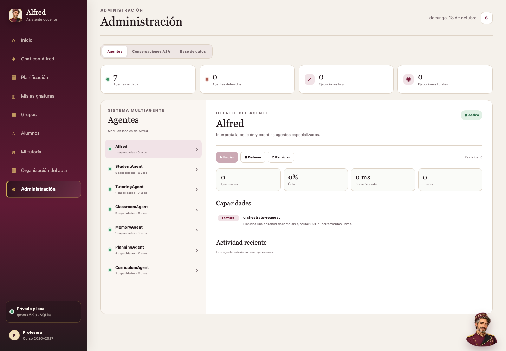 |

| Conversaciones A2A | Logs de ChatGPT |
|---|---|
| 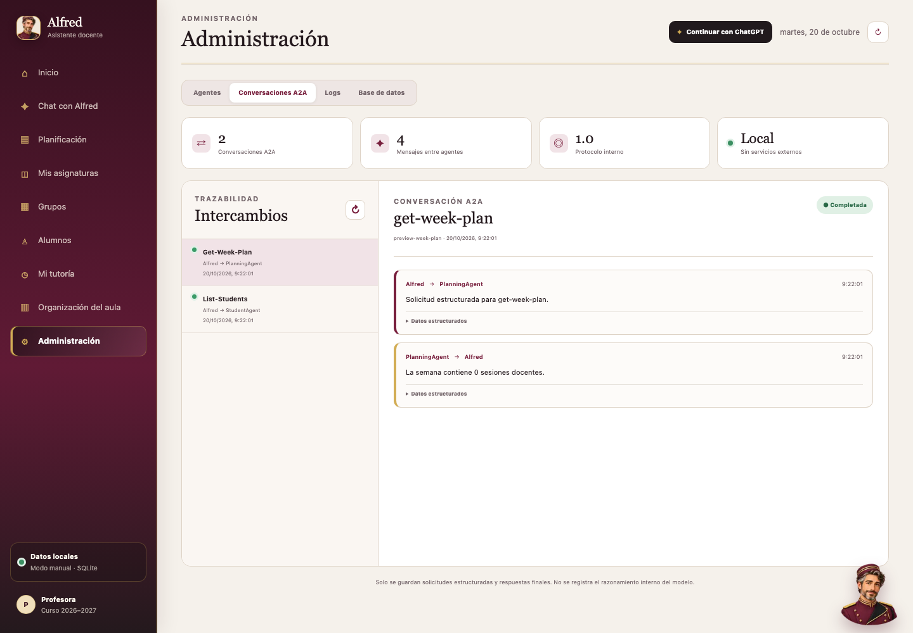 | 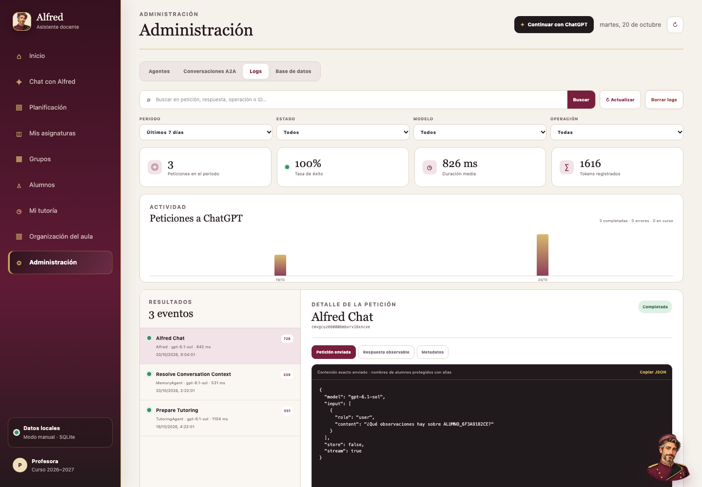 |

| Base de datos |
|---|
| 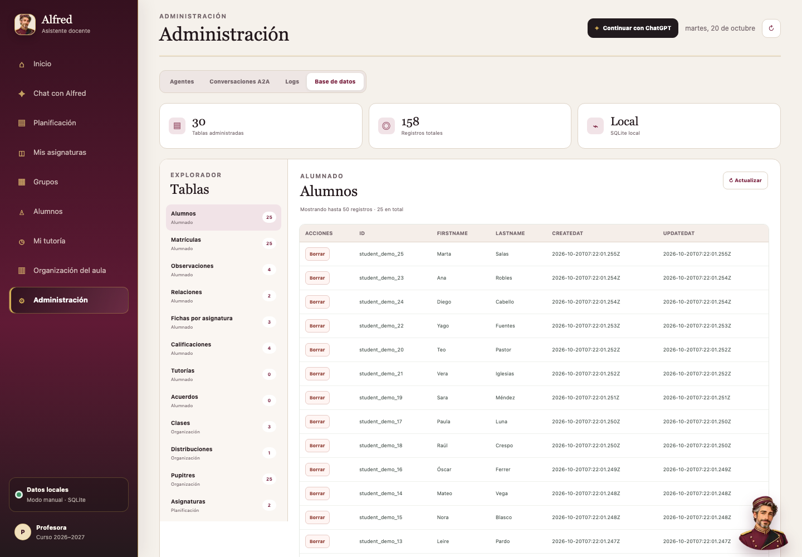 |

Las imágenes se generan con datos ficticios. Consulta también la [galería independiente](preview/README.md)
o regénérala localmente con `npm run preview:capture`.

## Requisitos

- Node.js `>=22.12.0 <23` (probado con 22.23.3).
- npm 10 o posterior.
- Git.
- Para el razonamiento conversacional se necesita una cuenta de ChatGPT elegible para el flujo de uso del plan.

## Instalación en macOS

```sh
git clone https://github.com/Adrute/project-alfred.git alfred
cd alfred
npm install
cp .env.example .env
npm run db:generate
npm run db:deploy
npm run db:seed
```

En otra terminal:

```sh
npm run dev
```

Abrir `http://127.0.0.1:3000`. Crea la primera cuenta administrativa como se explica en «Cuentas locales».
Entra como administrador y usa **Continuar con ChatGPT** para autorizar la cuenta en el navegador local.

## Instalación en Windows 11

En PowerShell, con Node.js y Git ya instalados:

```powershell
git clone https://github.com/Adrute/project-alfred.git alfred
Set-Location alfred
npm install
Copy-Item .env.example .env
npm run db:generate
npm run db:deploy
npm run db:seed
npm run dev
```

Abrir `http://127.0.0.1:3000` y crear la cuenta administrativa. No se deben copiar `node_modules` entre macOS y Windows: ejecutar
`npm install` en cada sistema. La compatibilidad está contemplada en el código, pero requiere una
ejecución real en Windows antes de declararla validada.

## Configuración

Copiar `.env.example` a `.env`. Las variables se validan al iniciar:

| Variable | Valor inicial | Propósito |
|---|---|---|
| `NEXT_TELEMETRY_DISABLED` | `1` | Desactiva telemetría de Next.js |
| `HOST` | `127.0.0.1` | Dirección local; `0.0.0.0` solo dentro del contenedor de producción |
| `PORT` | `3000` | Puerto local |
| `APP_ORIGIN` | `http://127.0.0.1:3000` | Origen exacto; en producción debe ser HTTPS |
| `CLOUD_AI_ENABLED` | `true` | Activa ChatGPT; ponerlo a `false` corta toda comunicación cloud |
| `CHATGPT_MODEL` | `gpt-6.1-sol` | Modelo preferido, sujeto al catálogo disponible para la cuenta conectada |
| `CHATGPT_OAUTH_CLIENT_ID` | vacío | Solo para un cliente web autorizado por OpenAI; en VPS autohospedada se importa la credencial autorizada en el Mac |
| `CHATGPT_LOCAL_CALLBACK_PATH` | vacío | Solo para un cliente local antiguo; **Registrar de nuevo** usa siempre `/auth/callback` |
| `DATABASE_URL` | `file:./data/alfred.db` | Archivo SQLite configurable |
| `DATA_DIRECTORY` | `./data` | Directorio local de datos |
| `LOG_LEVEL` | `info` | Nivel de registro |

El entorno local escucha en loopback. El contenedor Docker usa `HOST=0.0.0.0` para escuchar dentro del
bridge; el puerto publicado queda limitado al loopback del host.

### Cuentas locales

No hay registro web. Crea la cuenta inicial desde una terminal con acceso al mismo archivo SQLite:

```sh
npm run auth:user -- create profesora admin "Profesora"
```

La herramienta solicita la contraseña por TTY sin mostrarla, o la lee desde stdin. Para actualizar usa
`npm run auth:user -- update usuario admin|user [nombre]`; para listar, `npm run auth:user -- list`; y
para desactivar, `npm run auth:user -- disable usuario`. Las contraseñas tienen entre 12 y 128 caracteres.
Actualizar o desactivar revoca las sesiones anteriores. Los roles `admin` y `user` comparten los mismos
datos docentes; no existe aislamiento por cuenta.

Las sesiones duran 12 horas. Las escrituras validan el origen y un token CSRF.

## Comandos

```sh
npm run dev          # servidor local de desarrollo
npm run build        # compilación de producción
npm run start        # servidor local de producción
npm run lint         # análisis estático
npm run typecheck    # comprobación TypeScript
npm test             # pruebas unitarias
npm run test:e2e     # recorrido completo en Chromium
npm run agents:validate # valida roles y adaptadores del equipo de desarrollo
npm run branch:check # impide trabajar directamente en main/master o ramas sin convención
npm run ai:check      # comprueba la conexión OAuth y una salida estructurada de ChatGPT
npm run ai:eval       # evalúa la selección de herramientas con la cuenta conectada
npm run db:generate  # genera Prisma Client
npm run db:migrate   # crea/aplica una migración de desarrollo
npm run db:seed      # crea grupos, docencia, tutoría, horario y alumnado ficticio
npm run demo:prepare # añade observaciones ficticias y plano inicial idempotente
npm run preview:capture # regenera la galería de capturas con datos ficticios
npm run db:studio    # inspector local de la base
npm run auth:user -- list # listar cuentas locales
```

`GET /api/health` ofrece una comprobación mínima de disponibilidad de SQLite y no requiere sesión.

## Equipo de desarrollo multiagente

El repositorio incluye un equipo virtual para desarrollar Alfred: Orchestrator, Architect, Backend,
Frontend, Data, QA, Security, Documentation y Reviewer. El contrato neutral vive en `.agents/`; Codex y
Claude Code disponen de adaptadores nativos en `.codex/agents/` y `.claude/agents/`. Otras herramientas
pueden aplicar exactamente el mismo protocolo leyendo `AGENTS.md` y el manifiesto.

El orquestador elige la ruta mínima según área y riesgo, limita el paralelismo y reserva los modelos más
capaces para arquitectura, seguridad y revisión. Consulta el [flujo multiagente de desarrollo](docs/development/multi-agent-workflow.md).

El desarrollo se realiza siempre en ramas de trabajo. Los agentes no pueden integrar cambios en `main`
hasta recibir una confirmación explícita del propietario para esa entrega. Antes de tocar código consultan
el [catálogo de funcionalidades](docs/features/README.md), que dirige a fichas compactas con contratos,
invariantes, archivos y pruebas relevantes. Cada entrega actualiza también el [changelog](CHANGELOG.md).

## Conversaciones y agentes

Cada conversación conserva únicamente sus propios mensajes y un estado estructurado con foco, tema y
último resultado de herramienta. Con ChatGPT conectado, Alfred envía una ventana seudonimizada de los
últimos mensajes del chat activo, por lo que una continuación como «¿y alguno más?» mantiene el tema
sin necesidad de repetirlo y sin mezclar otros chats. La memoria estructurada sigue siendo la fuente de verdad.

ChatGPT actúa como orquestador mediante llamadas tipadas a herramientas. Recibe el historial con alias,
el estado conversacional y un catálogo Zod, puede encadenar resultados y Alfred valida cada llamada antes
de consultar los servicios de alumnos, memoria, aulas, planificación o currículo. Los resultados vuelven
al modelo seudonimizados y la respuesta recupera los nombres solo en el equipo. El modelo nunca recibe
acceso directo a SQLite. Sin conexión, una ruta determinista conserva las consultas y operaciones
básicas; ninguna escritura evita el flujo de confirmación. Alfred rechaza además cualquier afirmación
de haber consultado o preparado algo cuando no exista una ejecución real que la respalde.

Las respuestas de Alfred se presentan como Markdown seguro tanto en el chat completo como en la burbuja
contextual: negritas, listas, enlaces, tablas y bloques de código se convierten en elementos React sin
inyectar HTML procedente del modelo. Los resúmenes del historial se muestran como texto limpio.

## Interoperabilidad A2A

Alfred publica una Agent Card A2A 1.0 en `GET /.well-known/agent-card.json`. La interfaz anunciada es
HTTP+JSON. En local escucha en loopback; en producción requiere sesión `admin` y se alcanza detrás de
Tailscale Serve:

```text
POST /api/a2a/message:send
Content-Type: application/a2a+json
A2A-Version: 1.0
```

Las respuestas simples usan un `Message` A2A directo. Su `contextId` es el identificador de la
conversación de Alfred y permite continuar el diálogo. Si la petición crea una propuesta, la respuesta
incluye una parte de datos con el identificador de `PendingAction`; A2A no permite saltarse la
confirmación humana. En esta versión no se anuncian streaming, notificaciones push ni tareas A2A
persistentes. El adaptador es una frontera de interoperabilidad; los siete agentes continúan como
módulos locales y sus capacidades aparecen como skills de Alfred.

Dentro del proceso, Alfred delega cada herramienta especializada mediante el mismo modelo de datos
A2A 1.0: `Message`, `Task`, estado terminal y `Artifact`. Es un binding local síncrono, sin llamadas de
red entre módulos. Las solicitudes y respuestas se guardan en `AgentConversation` y `AgentMessage` y
pueden revisarse en **Administración → Conversaciones A2A**. Solo se persisten argumentos estructurados,
respuestas finales y metadatos de enrutado; nunca prompts del sistema ni razonamiento interno.

En la arquitectura actual los agentes son módulos internos del proceso de Alfred, no procesos del sistema operativo.
Los controles de Administración habilitan o bloquean de forma persistente la ejecución de cada módulo;
reiniciar restablece su estado operativo y registra el reinicio. Las estadísticas proceden de
`AgentExecution` y no contienen razonamientos internos.

## Trasladar la base de demostración

1. Detener Alfred en el equipo de origen.
2. Para una demostración local ficticia, copiar la base por un medio autorizado; no versionarla ni enviarla
   mediante el repositorio.
3. Para Coolify, conserva el directorio completo de datos y sigue el procedimiento de backup/restauración
   de [DEPLOYMENT.md](DEPLOYMENT.md), que requiere detener el servicio.

Esta versión solo puede utilizar datos ficticios. Una base con datos reales requiere una política y un
canal de transferencia aprobados por el centro.

## Privacidad y seguridad

- La aplicación local escucha en `127.0.0.1`; el contenedor escucha en `0.0.0.0` dentro de su red bridge
  y publica el puerto solo en loopback del host.
- No se incluyen telemetría, CDNs ni analítica. ChatGPT se limita a los endpoints oficiales fijados en
  código; `CLOUD_AI_ENABLED=false` actúa como corte de emergencia.
- Los nombres del alumnado, identificadores internos, correos y teléfonos se sustituyen localmente.
  Cada alumno usa un alias HMAC-SHA-256 único dentro de la conversación, distinto entre conversaciones y
  ajeno a las claves de SQLite. Una segunda barrera inspecciona el payload final y bloquea la red si
  sobrevive cualquier identidad real conocida.
- Las credenciales OAuth nunca se entregan al navegador, se excluyen de Git y se guardan con permisos
  de propietario cuando el sistema operativo lo permite.
- Las peticiones de Responses API usan streaming y `store: false`.
- Las trazas nuevas guardan metadatos operativos, sin cuerpos de petición ni respuesta. La API de
  administración también redacta esos campos en registros históricos; nunca expone cabeceras OAuth ni
  razonamiento interno.
- El LLM nunca recibe acceso SQL: propone operaciones tipadas, que deben confirmarse y ejecutarse
  mediante servicios de dominio.
- SQLite no cifra el archivo. Usar FileVault en macOS o BitLocker en Windows.

La guía reproducible de comprobación offline está en [docs/security/offline-verification.md](docs/security/offline-verification.md).

## Producción

Consulta [DEPLOYMENT.md](DEPLOYMENT.md) para desplegar desde GitHub privado en Coolify detrás de Tailscale
Serve, conservar SQLite y realizar copias y restauraciones. Alfred ofrece PWA standalone y no instala un
service worker ni almacena datos sensibles en caché offline. La prueba móvil disponible usa Chromium;
Safari e iPhone real siguen pendientes de validación.

## Documentación

- [Changelog](CHANGELOG.md)
- [Catálogo de funcionalidades](docs/features/README.md)
- [Arquitectura](docs/architecture/overview.md)
- [Modelo del planificador](docs/architecture/planning-model.md)
- [Decisiones técnicas](docs/architecture/decisions.md)
- [Plan incremental](docs/development/plan.md)
- [Auditoría del entorno](docs/development/environment-audit.md)
- [Seguridad y verificación offline](docs/security/offline-verification.md)
- [Despliegue Docker y Coolify](DEPLOYMENT.md)
- [Guion de demostración](docs/development/demo.md)
- [Equipo multiagente de desarrollo](docs/development/multi-agent-workflow.md)

## Limitaciones actuales

- La compatibilidad arquitectónica con Windows está implementada, pero todavía requiere una ejecución
  real en Windows 11 para considerarse validada.
- El botón OAuth directo en HTTPS necesita un cliente web autorizado por OpenAI. En una VPS
  autohospedada puede importarse la credencial protegida autorizada con Alfred en el Mac. Ninguna vía
  habilita inferencia sin `chatgpt.tokens.use.direct`; consulta `DEPLOYMENT.md`.
- El solver usa búsqueda heurística reproducible con 2.000 intentos; garantiza restricciones duras en
  el resultado, pero no demuestra óptimo global para aulas mayores o restricciones futuras.
- La evaluación de intención debe pasar completa con el modelo configurado antes de una entrega.
- `npm audit` no detecta vulnerabilidades de producción; existe un aviso en herramientas de lint por
  una dependencia transitiva (`braces`) sin corrección no disruptiva. Se revisará al actualizar
  `eslint-config-next`; no se usa durante la ejecución de la aplicación.
