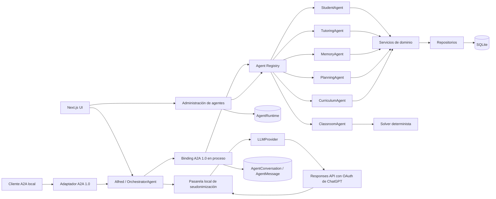
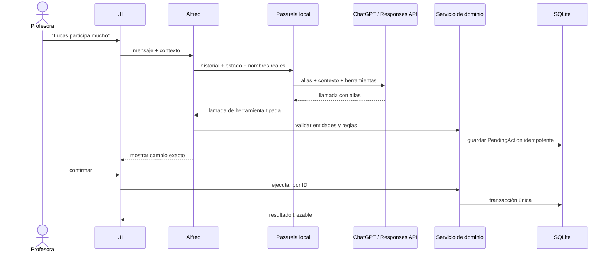

# Arquitectura de Alfred

## Componentes

La aplicación es un monolito modular. Los agentes son módulos internos con contratos tipados, no
microservicios. El adaptador A2A 1.0 del borde publica las capacidades de Alfred y reutiliza el mismo
orquestador. Para las delegaciones internas, Alfred usa un binding síncrono en proceso con los objetos
canónicos `Message`, `Task` y `Artifact`; no introduce transporte distribuido ni puertos por agente.

## Contexto de conversación

Cada chat se persiste como una entidad `Conversation` con sus propios `Message`. El cliente permite
crear y volver a abrir conversaciones. La interfaz mantiene además una burbuja global de Alfred: al
enviar un mensaje adjunta un contexto visual transitorio, validado con Zod, que contiene la vista,
un resumen acotado y los identificadores de alumnos que están realmente visibles. La burbuja no cambia
de página al conversar y la misma conversación puede abrirse después en la vista de chat completa.

Alfred conserva un foco conversacional estructurado con tema, alumnos activos y el último resultado de
herramienta. Con una cuenta autorizada, ChatGPT recibe este estado y el historial del chat actual ya
seudonimizados, elige herramientas tipadas y
puede encadenar sus resultados. Los servicios resuelven nombres e identificadores contra SQLite antes
de consultar o proponer cambios. El foco se persiste en `Conversation.contextJson`, sobrevive a la
reapertura del chat y nunca se obtiene de otra conversación.

El foco y el contexto de pantalla son estado efímero de diálogo, no memoria docente: no crean alumnos,
observaciones ni hechos. El resumen visual no se persiste como memoria estructurada.
Los hechos confirmados permanecen en las tablas estructuradas y pueden consultarse desde cualquier
conversación; el historial conversacional no se convierte en un hecho por sí solo. Si una referencia
es ambigua o no coincide con un alumno existente, Alfred pregunta en vez de inventar un identificador.

## Control operativo de agentes

`AgentRuntime` conserva el estado `running` o `stopped`, las marcas de inicio, parada y reinicio y el
número de reinicios. El orquestador comprueba su estado antes de atender un mensaje, y cada ruta
especializada comprueba el agente elegido antes de ejecutar su caso de uso. El panel combina este
estado con `AgentExecution` para mostrar usos, errores, tasa de éxito, duración media, operaciones y
actividad reciente.

Los agentes que realizan inferencias declaran `usesAi`. Para ellos, `AgentRuntime.aiModel` puede fijar
uno de los modelos disponibles para la cuenta conectada; si queda vacío, heredan el modelo de la sesión.
La preferencia se resuelve en la factoría de proveedores antes de cada petición y no altera capacidades,
permisos ni confirmaciones. Los agentes deterministas no ofrecen este selector.

Como Alfred es un monolito local, iniciar, detener y reiniciar son controles lógicos persistentes de
los módulos; no crean ni destruyen procesos del sistema operativo. Este límite mantiene el producto
local verificable. El protocolo A2A describe la delegación y su trazabilidad, pero no cambia estos
controles lógicos ni convierte módulos en procesos independientes.

## Administración de la base de datos

El panel de Administración incorpora un explorador local de SQLite basado exclusivamente en un
catálogo cerrado de tablas y operaciones Prisma. No acepta SQL, comandos, rutas ni nombres de tabla
arbitrarios. Permite consultar recuentos y hasta 50 registros recientes por tabla.

El borrado puede hacerse sobre un registro concreto, un área funcional o todos los datos. Todas las
operaciones destructivas exigen escribir una frase exacta de confirmación y el servicio vuelve a
validarla antes de ejecutar una transacción. El borrado total conserva el esquema y las migraciones;
elimina únicamente los datos de la aplicación. Las pruebas destructivas usan una base SQLite temporal.

## Flujo de una escritura conversacional

Las lecturas y funciones deterministas siguen disponibles sin iniciar sesión. ChatGPT solo se utiliza
después de una autorización OAuth explícita y nunca recibe acceso directo a SQLite.

## Orquestación de consultas abiertas

ChatGPT recibe el historial seudonimizado del chat activo, el estado estructurado y un catálogo declarativo de
herramientas de lectura y propuesta. Devuelve llamadas nativas cuyos argumentos se validan con Zod,
nunca SQL ni una llamada libre. El orquestador comprueba que el agente correspondiente esté activo,
traduce los alias, ejecuta la herramienta mediante su servicio de dominio y devuelve el resultado
seudonimizado al modelo para que redacte la respuesta. La respuesta recupera los nombres localmente.
Así, filtros, entidades y resultados se mantienen entre turnos sin enumerar cada
posible formulación.

Las reglas deterministas actúan como modo manual cuando ChatGPT no está conectado o no está disponible. Las
mutaciones siguen creando una `PendingAction` y requieren confirmación explícita: la selección del
modelo no amplía permisos. Si el modelo afirma haber ejecutado trabajo sin llamada real, Alfred fuerza
una autocorrección antes de mostrar la respuesta.

Los alias de alumno se calculan con HMAC a partir de un secreto local y el identificador de la
conversación. No son claves de SQLite, permanecen estables dentro del chat y cambian entre chats. La
pasarela reemplaza también nombres que aparecen dentro de observaciones, resultados de herramientas y
contexto de pantalla, además de correos y teléfonos. Las credenciales OAuth se guardan en un archivo
local excluido de Git y nunca se entregan al navegador.

## Logs de ChatGPT

El proveedor registra una `CloudAiTrace` antes de cada llamada externa. La traza contiene exactamente el
cuerpo JSON seudonimizado que se envía a Responses API y, al finalizar, una representación de la respuesta
observable sin elementos de razonamiento. También conserva `x-request-id`, identificador de respuesta,
modelo, operación, uso de tokens y duración. La pestaña **Administración → Logs** ofrece búsqueda de texto,
filtros, histograma, detalle JSON y borrado explícito. Las credenciales solo se incorporan a la cabecera de
red y nunca forman parte de la traza.

`CloudAiTrace.agentId` relaciona cada petición con el agente que la originó. Esto permite comprobar desde
el panel qué agente usó qué modelo, incluso cuando varios agentes generativos tienen preferencias distintas.

## Presentación de respuestas

La salida visible de Alfred acepta un subconjunto controlado de Markdown y se transforma directamente en
nodos React. No se inyecta HTML del modelo. El mismo renderizador se utiliza en el chat completo y en el
asistente flotante; para la vista previa de conversaciones se eliminan las marcas y se conserva solo texto.

## Propiedad de datos

- Student: alumnos, matrículas, observaciones y relaciones.
- Tutoring: sesiones y acuerdos; consulta Student mediante servicio.
- Classroom: aulas, planos y asignaciones; consulta restricciones confirmadas mediante servicio.
- Memory: conversaciones y recuperación coordinada; no sustituye el modelo estructurado.
- Planning: horarios recurrentes, excepciones, sesiones fechadas, actividades y ejecuciones.
- Curriculum: asignaturas, asignaciones docentes, unidades, contenidos y progreso.
- Orchestrator: intención, coordinación, confirmaciones y presentación; no implementa reglas propias.

## Persistencia

Prisma 7 usa `@prisma/adapter-better-sqlite3`. `DATABASE_URL` admite una ruta `file:` configurable y
se normaliza con `node:path` durante la ejecución. Las relaciones aplican borrado en cascada donde la
entidad hija no tiene significado independiente, índices para recorridos previstos y unicidad en
asientos, matrículas e idempotencia.

## Semántica del plano

- `adyacentes` o `juntos`: distancia Manhattan exactamente 1 (lado compartido; no diagonal).
- `cerca de la pizarra`: filas de índice 0 o 1, siendo 0 la primera fila.
- `separados`: no pueden estar adyacentes.
- Asientos bloqueados: se eliminan del conjunto antes de asignar.
- Restricciones duras: cercanía confirmada, separación y bloqueos; cualquier propuesta que las
  incumpla se rechaza.
- Preferencias: parejas que trabajan bien; cada adyacencia satisfecha suma 10 puntos.

La búsqueda usa barajado seudoaleatorio reproducible y hasta 2.000 intentos. Una edición manual se
valida de nuevo contra las restricciones duras antes de persistirse.

## Flujo de planificación

`WeeklyTimetable` y `TimetableSlot` describen la recurrencia. PlanningAgent materializa `LessonPlan`
para una semana de forma idempotente y aplica las excepciones de fecha. CurriculumAgent aporta la
unidad activa y sus contenidos pendientes. Una planificación propuesta desde el chat se guarda como
`PendingAction`; las actividades no se crean hasta recibir confirmación. La edición explícita desde el
panel crea una entrada de `PlanningChange` para conservar trazabilidad.

## Adaptador A2A

La Agent Card se sirve en `/.well-known/agent-card.json` y anuncia HTTP+JSON 1.0 en `/api/a2a`.
`POST /api/a2a/message:send` transforma el mensaje estándar en una petición al mismo servicio de chat
y devuelve una respuesta A2A con `contextId`. Las propuestas incluyen solo metadatos de la acción
pendiente y nunca se ejecutan desde el adaptador. La interfaz no anuncia tareas persistentes,
streaming ni push hasta que esos ciclos de vida estén implementados y probados.

Las llamadas de Alfred a un agente especializado usan además un binding A2A 1.0 interno: la solicitud
se registra como `Message` con partes de texto y datos; la respuesta se conserva como `Task` completada
con su `Artifact` estructurado. El panel de Administración reconstruye estas conversaciones desde
`AgentConversation` y `AgentMessage`. Este registro excluye deliberadamente prompts y razonamiento
interno, y se elimina desde los ámbitos de conversaciones, historial de agentes o borrado total.
