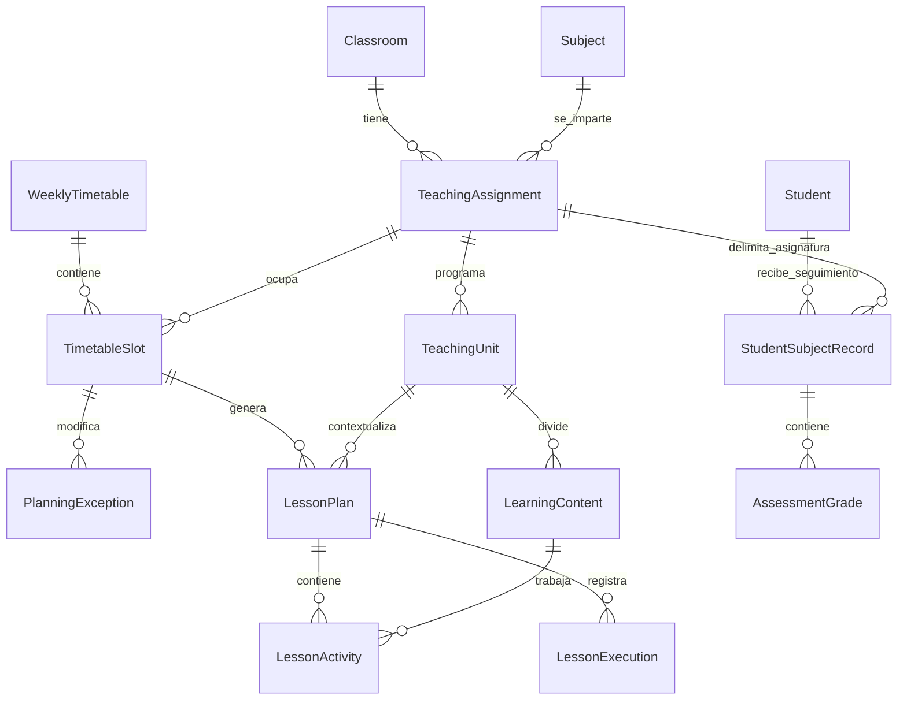

# Modelo del Planificador Docente

## Estructura

## Invariantes

- Una asignación docente es única por asignatura, grupo y curso académico.
- Una franja no puede solaparse con otra franja activa del mismo horario.
- La hora final siempre es posterior a la inicial.
- Una franja genera como máximo una sesión por fecha.
- La suma de actividades no puede superar la duración de la sesión.
- Una excepción cancela o modifica una sola aparición sin alterar la recurrencia.
- La planificación original, las ejecuciones confirmadas y los cambios se conservan por separado.
- El progreso curricular deriva de contenidos vinculados a actividades confirmadas, nunca solo de una
  inferencia del modelo.
- Una ficha académica pertenece siempre a un alumno y a una asignación docente concreta; una nota de
  Inglés no se mezcla con Alemán ni con el seguimiento tutorial general.
- `Classroom.isTutorGroup` identifica el único grupo que la profesora tutoriza. Este rol es independiente
  de las asignaturas que imparta en ese u otros grupos.

Las fechas de calendario se normalizan a medianoche UTC y no representan una hora instantánea. Las
horas lectivas se almacenan como minutos desde medianoche junto con `Europe/Madrid`, lo que evita
desplazamientos por cambios de horario de verano.
