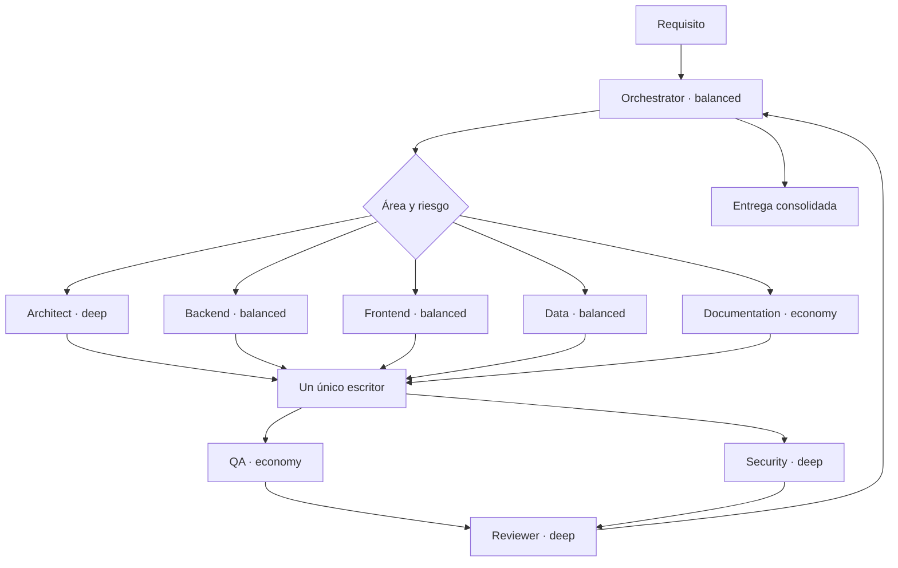

# Equipo multiagente de desarrollo

## Diseño

El equipo de desarrollo es independiente de los agentes docentes de Alfred. Su contrato canónico es neutral
respecto al proveedor y vive en `.agents/`; Codex y Claude Code solo añaden adaptadores de ejecución.

El orquestador no reúne siempre a todos. Selecciona la ruta mínima según `.agents/orchestration.md`, limita
el trabajo simultáneo a tres especialistas y evita dos escritores concurrentes sobre el mismo árbol.

## Rama y contexto antes de trabajar

Todo cambio comienza con `npm run branch:check`. `main` y `master` son ramas protegidas para el trabajo de
los agentes; se crea una rama con prefijo `feature/`, `fix/`, `docs/`, `chore/`, `refactor/`, `test/` o
`release/`. Tener una rama lista, commits o una pull request no autoriza su integración: el propietario debe
confirmar explícitamente cada merge a `main`.

El orquestador consulta `docs/features/manifest.json`, selecciona por palabras clave una o varias fichas y
entrega a los especialistas solo esos documentos y puntos de entrada. Una exploración global se reserva a
cambios realmente transversales y debe justificarse. Esto mantiene el contexto pequeño sin perder los
contratos e invariantes del producto.

## Roles

| Rol | Responsabilidad | Perfil inicial |
|---|---|---|
| Orchestrator | requisitos, riesgo, enrutado, handoffs y entrega | balanced |
| Architect | límites, contratos y decisiones transversales | deep |
| Backend | dominio, servicios, repositorios, IA y API | balanced |
| Frontend | React, accesibilidad y comportamiento observable | balanced |
| Data | Prisma, SQLite, migraciones, índices y seed | balanced |
| QA | reproducción y pruebas proporcionales al riesgo | economy |
| Security | privacidad, autenticación, permisos y borrados | deep |
| Documentation | README, configuración, arquitectura y guías | economy |
| Reviewer | revisión independiente del resultado final | deep |

## Perfiles de modelo

Los roles no contienen nombres comerciales. El manifiesto asigna un perfil estable y cada adaptador lo
traduce a un modelo de su plataforma:

| Perfil | Uso | Codex | Claude Code |
|---|---|---|---|
| economy | tareas claras, repetibles y de gran volumen | GPT-6 Luna, high | Haiku, high |
| balanced | implementación habitual y orquestación | GPT-6.1 Sol, medium | Sonnet, medium |
| deep | arquitectura, seguridad y revisión crítica | GPT-6.1 Sol, high | Opus, high |

Si un proveedor no ofrece el modelo indicado, debe usar el modelo disponible más cercano al propósito del
perfil y dejar constancia en la entrega. El orquestador escala temporalmente un perfil únicamente ante
riesgo alto, ambigüedad real, evidencia contradictoria o dos intentos fallidos.

## Uso por herramienta

### Codex

Codex carga `AGENTS.md`. Los agentes nativos se encuentran en `.codex/agents/*.toml` y el límite de
concurrencia en `.codex/config.toml`. Una petición no trivial se dirige al agente `orchestrator`, que puede
invocar los especialistas necesarios.

### Claude Code

Claude Code carga `CLAUDE.md`, que importa las reglas comunes, y descubre `.claude/agents/*.md`. Los
adaptadores contienen el modelo, el esfuerzo y una referencia al contrato neutral correspondiente.

### Otras herramientas

Cualquier asistente capaz de leer el repositorio puede utilizar el mismo sistema:

1. Leer `AGENTS.md` y `.agents/orchestration.md`.
2. Leer `.agents/manifest.json`.
3. Adoptar el rol `.agents/roles/orchestrator.md`.
4. Para cada delegación, cargar solo el contrato del especialista elegido.
5. Mapear `economy`, `balanced` y `deep` a sus modelos disponibles.
6. Respetar el paquete de handoff y las puertas de calidad.

La ejecución nativa de subagentes depende de cada herramienta; el contrato, las responsabilidades y los
criterios de calidad no. Esto evita que la arquitectura del equipo dependa de una API o CLI concreta.

## Mantenimiento

Al crear, renombrar o cambiar el perfil de un rol:

1. Actualizar `.agents/manifest.json` y su contrato en `.agents/roles/`.
2. Actualizar los adaptadores de Codex y Claude Code.
3. Ejecutar `npm run agents:validate`.
4. Ajustar este documento si cambia el flujo o la política de modelos.
5. Ejecutar las comprobaciones normales del proyecto.

Cada cambio funcional mantiene además:

1. `CHANGELOG.md`, bajo `Unreleased`, con el efecto relevante y no con el detalle de cada commit.
2. La ficha propietaria de `docs/features/` si cambian recorridos, contratos, invariantes, puntos de entrada
   o pruebas.
3. `docs/features/manifest.json` cuando aparece una capacidad nueva o cambia su ruta principal.

El validador comprueba identificadores, perfiles, contratos, modelos, esfuerzo, referencias canónicas,
changelog, catálogo funcional, puntos de entrada y límite de concurrencia. CI vuelve a ejecutar esta
comprobación en Linux y Windows.
