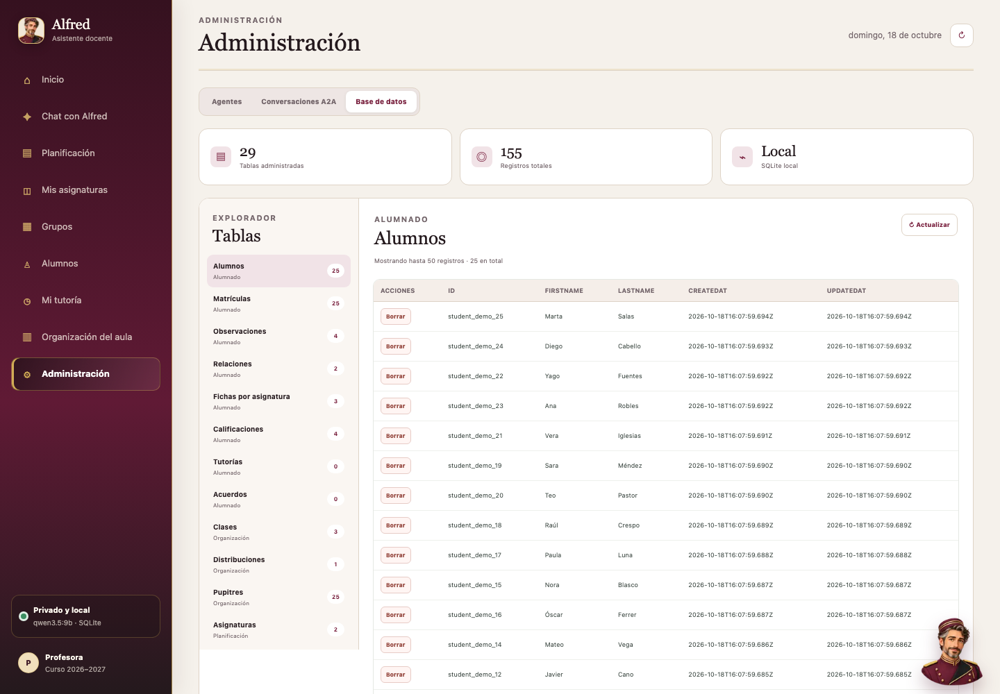

# Galería de Alfred

Todas las capturas se generan con datos completamente ficticios mediante `npm run preview:capture`.

| Inicio | Alfred contextual |
|---|---|
|  |  |

| Chat | Planificación |
|---|---|
|  |  |

| Asignatura | Grupo |
|---|---|
|  |  |

| Alumno | Tutoría |
|---|---|
|  |  |

| Organización del aula | Agentes |
|---|---|
|  |  |

| Conversaciones A2A | Base de datos |
|---|---|
|  |  |
